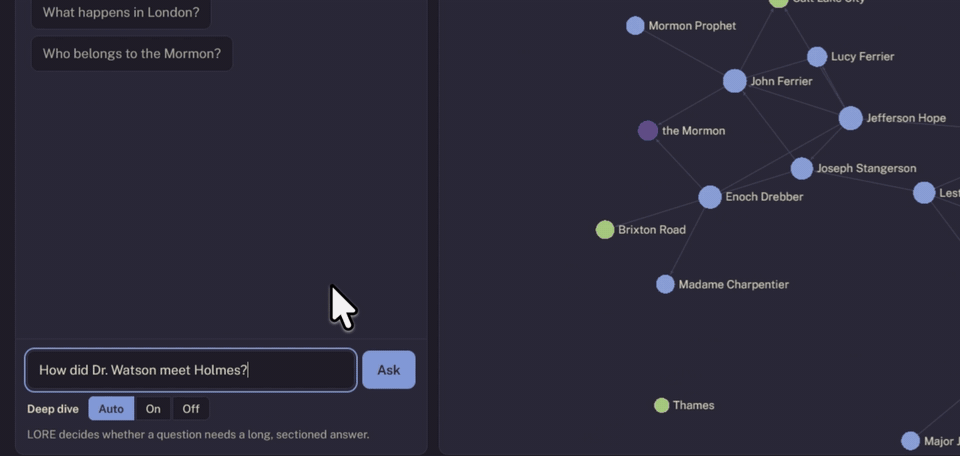
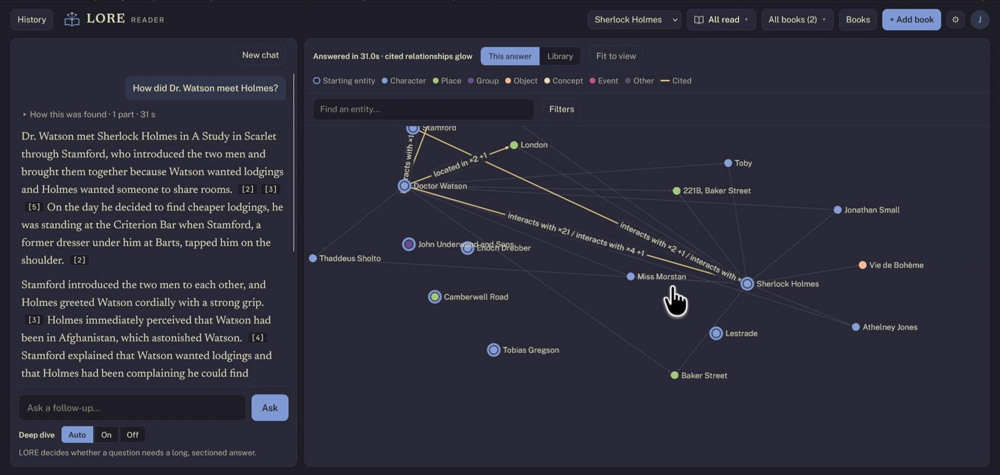
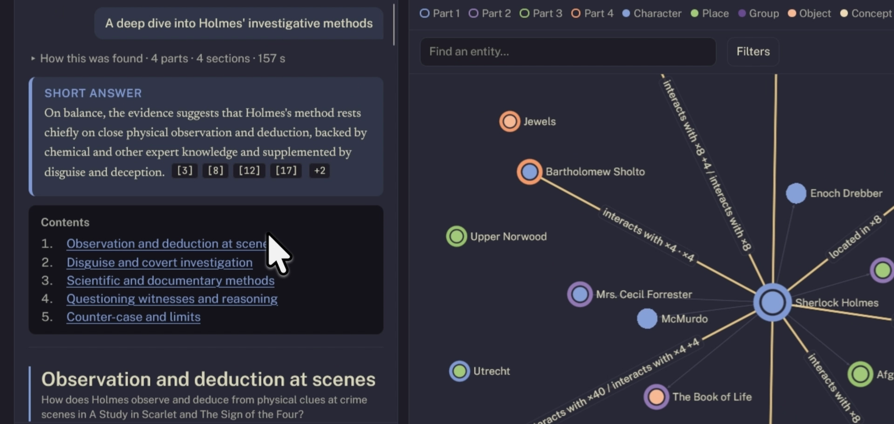

<p align="center">
  <picture>
    <source media="(prefers-color-scheme: dark)" srcset="docs/brand/lore-lockup-dark.svg">
    
  </picture>
</p>

<p align="center">
  <strong>Ask questions about the books you own.</strong><br>
  Every sentence cited from the text. Nothing past the chapter you're on.
</p>

<p align="center">
  <a href="https://github.com/Jatin-Roopchandani/LORE/actions/workflows/ci.yml"></a>
  <a href="LICENSE"></a>
  
  <a href="https://lore.jrvn.site"></a>
</p>

<p align="center">
  <a href="https://lore.jrvn.site">Live beta</a> ·
  <a href="docs/guide.md">User guide</a> ·
  <a href="docs/how-it-works.md">How it works</a> ·
  <a href="https://lore.jrvn.site/blog">Blog</a> ·
  <a href="https://github.com/Jatin-Roopchandani/LORE/issues">Issues</a>
</p>

<p align="center">
  
</p>

LORE is an open-source AI reader for your e-books. It turns each book into a
**knowledge graph** of its characters, places, groups and events, then answers
your questions **from the text itself**: every sentence in an answer cites the
passage it comes from, and a second pass checks each one against that passage
and cuts what the book doesn't say. Tell it how far you've read, and it never
looks past your chapter.

## Features

- **Answers you can check.** Every sentence cites its passage; click a citation to read it in the book.
- **Spoiler-safe.** Set your reading progress per book. Answers, the graph, character profiles and timelines all stop at your chapter, enforced at retrieval, so the model never sees what comes later.
- **Questions across a series.** How a character changes from book one to book five, how a world or magic system works, who knows whom.
- **Deep dives.** Long, sectioned analyses with LORE's reading, the other side, and what the books leave open, all cited.
- **Explore the graph.** Click any character for a profile, a story timeline and their relationships, each with the passage behind it.
- **Bring your own model.** Gemini (the free tier works), Claude or OpenAI for reading and writing; embeddings run locally on Ollama.
- **Use it from Claude.** An MCP server lets claude.ai, Claude Desktop, Claude Code or any MCP client search your library and ask LORE questions.
- **Private by design.** Self-host it on your own machine, or use the hosted beta where each reader's library is kept separately.

<p align="center">
  
</p>

## Try it

The fastest way is the hosted beta at **[lore.jrvn.site](https://lore.jrvn.site)**:
request an invite on the homepage. New accounts start with *A Study in Scarlet*
already processed, so you can ask questions straight away. You'll need a free
Gemini API key (or a Claude or OpenAI key); the app walks you through it.

## Run it yourself

With Docker, for you and the people you add:

```bash
curl -fsSLO https://raw.githubusercontent.com/Jatin-Roopchandani/LORE/main/docker-compose.yml
docker compose up -d
docker compose logs lore | grep "setup code"   # a one-time code
# open http://localhost:8080, enter the code and create the admin account
```

Choose the AI model on the admin page: Gemini, Claude or OpenAI with your key,
or a model you run yourself (llama.cpp's llama-server, vLLM, LM Studio,
Ollama). Each person you add gets their own private library. The
[self-hosting guide](docs/self-hosting.md) covers requirements, a local model
step by step, adding people, upgrades, backups, HTTPS and troubleshooting.

### From source

For development, or a single-user install with no Docker.

**Prerequisites:** [Python 3.12+](https://www.python.org/downloads/),
[uv](https://docs.astral.sh/uv/getting-started/installation/),
[Node.js 18+](https://nodejs.org/) and [Ollama](https://ollama.com/download).

```bash
# 1. The local embedding model (keep Ollama running)
ollama pull nomic-embed-text

# 2. A model key: a free Gemini key from https://aistudio.google.com/apikey
export GEMINI_API_KEY=your-key-here

# 3. Install, and check everything is in place
git clone https://github.com/Jatin-Roopchandani/LORE.git
cd LORE
uv sync
uv run lore doctor

# 4. Build the web app (once)
cd web && npm install && npm run build && cd ..

# 5. Start it
uv run lore ui
```

Open **http://127.0.0.1:8766**, click **+ Add book**, and choose an EPUB or PDF
you own. The Library panel shows processing as it goes (a novel takes a while on
Gemini's free tier); when it's done, ask away.

Prefer the command line? `lore ingest`, `lore process` and `lore ask` do the
same; see the [user guide](docs/guide.md). Instead of the environment variable,
the key can also live in `~/.config/lore/gemini.env` (mode 600).

No cloud key? Run every step on your own model (llama-server, vLLM, LM Studio or
Ollama): see [Running fully local](docs/guide.md#running-fully-local).

## Use it from Claude

LORE runs an MCP server, so Claude can search your library and ask LORE
questions with your reading position applied:

- **Hosted beta:** in claude.ai, open Settings → Connectors → *Add custom connector* and paste `https://lore.jrvn.site/mcp`.
- **Self-hosted:** run `uv run lore mcp` (stdio) or `uv run lore mcp --http`.

Step by step: [Use your ebook library in Claude](https://lore.jrvn.site/blog/use-your-ebook-library-in-claude) and the [user guide](docs/guide.md#ask-lore-from-an-mcp-client).

## How it works

```
book (EPUB/PDF) → chapters & passages → LLM extraction → entity resolution
               → Kuzu graph + LanceDB vectors

question → split into parts → starting entities → graph walk → passages
         → claims, each quoting a passage → check every claim → cited prose
```

Reading progress becomes a per-book chapter cap applied as a prefilter on every
vector search, graph query and profile, so later chapters are never retrieved.
Behaviour changes ship behind switches, each judged by blind paired evals on
held-out questions. The full pipeline, models and design decisions are in
[How LORE works](docs/how-it-works.md).

<p align="center">
  
</p>

**Stack:** Python, FastAPI, Kuzu (graph), LanceDB (vectors), SQLite and
Postgres, Ollama (embeddings), React and TypeScript. The hosted beta runs on
Docker Compose behind a Cloudflare Tunnel ([deploy/](deploy/)).

## Project status

LORE is in **beta**. It works end to end on full novels and series, and the
test suite (4,000+ server tests, 800 web tests) runs on every push. Known
limits: answers are only as good as the extraction, long series take a while to
process, and a book must be one you can upload as EPUB or PDF.

## Contributing

Bug reports, ideas and pull requests are welcome. See
[CONTRIBUTING.md](CONTRIBUTING.md) for setting up a development environment and
running the tests. To report a security issue, please follow
[SECURITY.md](SECURITY.md) rather than opening a public issue.

## License

[MIT](LICENSE) © Jatin Roopchandani
